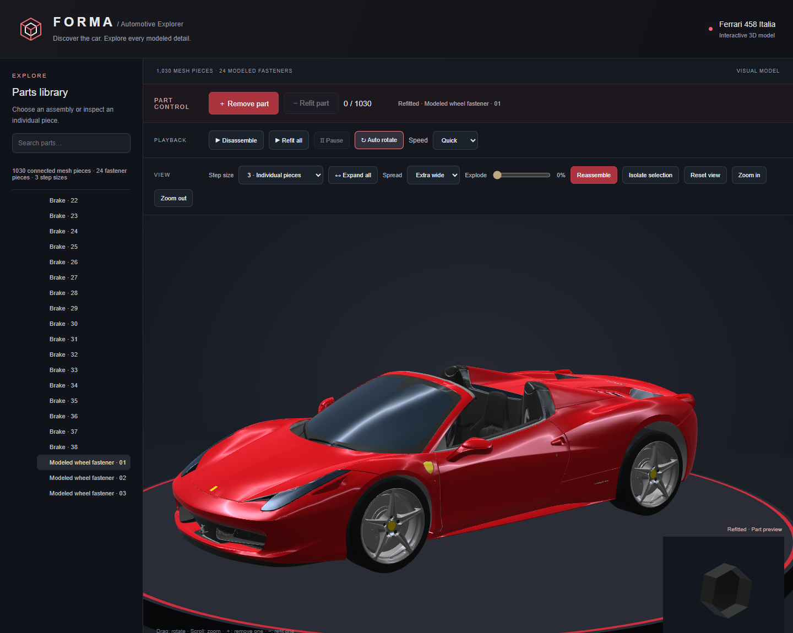

# FORMA — Automotive Explorer

Explore a Ferrari 458 artist model in 3D, disassemble its connected mesh pieces, and try an arcade driving demonstration.

## Features

- Rotate, zoom, search the parts tree, and inspect individual pieces.
- Remove and refit pieces, play automatic disassembly, and adjust the exploded view.
- Circular showroom platform and an arcade driving mode with keyboard and touch controls.
- Driver console with ignition, RPM display, accelerator, brake, lights, horn, and synthesized RPM audio.

## Run locally

index.html is at the root so Python serves the viewer directly.

Start a terminal in this folder and run:

    python -m http.server 8000 --bind 127.0.0.1

Open http://localhost:8000 in your browser. Stop the server with Ctrl+C.

## Project structure

Folders: src (editable viewer modules), assets (model and prepared geometry), templates (renderer), tests (browser checks), and previews (screenshots). Original processing intermediates remain in a local source-archive folder and are excluded from Git.

## Build and checks

To rebuild from this folder with Node.js: npm run build. No build packages are required. The builder combines the native WebGL renderer, compressed geometry, and interface modules into index.html.

For browser tests, install development dependencies with npm install, then run npm test. Chrome is required; set CHROME_PATH if it is not installed in the default Windows location.

## Fidelity and credits

The website contains its model data and requires no download at runtime. It needs a modern browser with WebGL, gzip decompression, and Web Audio support. Attribution links are external.

Ferrari 458 artist model by vicent091036, CC BY 4.0, distributed with the three.js car example. See NOTICE.md for attribution and modification notes. This is an independent viewer with no Ferrari affiliation.

The 1,030 connected mesh pieces include 24 modeled fastener pieces; they are not verified manufacturing parts. This is an artist model, not Ferrari factory CAD. Original engine CAD is not included. Driving, horn, RPM audio, and lighting are illustrative simulations. No separate reuse license has been chosen for the custom viewer code.
